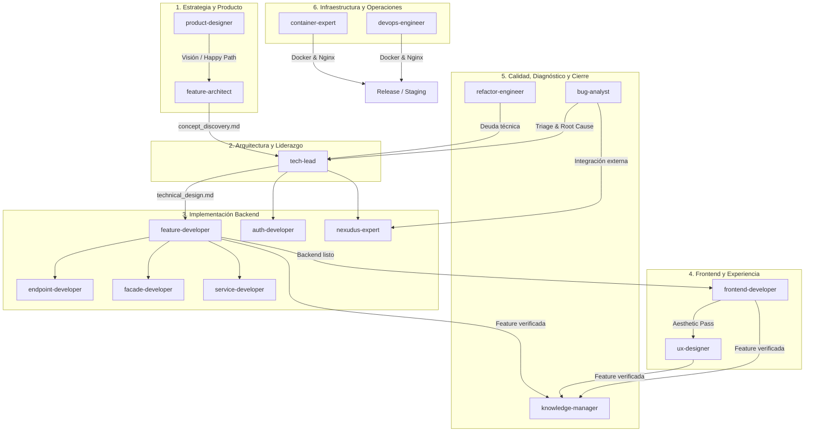
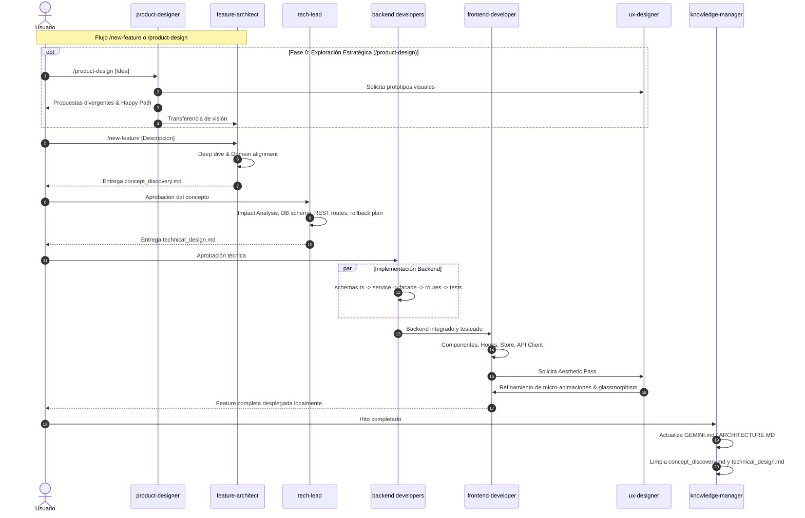

# Arquitectura del Sistema de Skills de Magma: Responsabilidades, Workflows y Puntos de Entrada

Este documento sintetiza la estructura organizativa de agentes y *skills* del proyecto **Magma**. Define la especialización de cada rol, las restricciones críticas de frontera, la orquestación de flujos de trabajo (*workflows*) de extremo a extremo y los puntos de entrada oficiales.

---

## 1. Mapa de Responsabilidades por Dominio

El ecosistema de Magma se compone de **16 skills especializadas**, agrupadas en 6 dominios operativos:



### 1.1. Estrategia y Producto
* [**`product-designer`**](skills/product-designer/SKILL.md):
  * **Responsabilidad**: Guardián de la coherencia estratégica a largo plazo. Brainstorming divergente (mínimo 2 enfoques), diseño de flujos de usuario (*Happy Path*) y prototipado conceptual.
  * **Límite/Restricción**: Prohibición técnica total (sin mención de archivos, tablas o código). Debe consultar obligatoriamente `docs/product/PRODUCT_DECISIONS.md`.
* [**`feature-architect`**](skills/feature-architect/SKILL.md):
  * **Responsabilidad**: Descubrimiento y definición funcional. Convierte ideas en historias de usuario, reglas de negocio y capacidades funcionales en `concept_discovery.md`.
  * **Límite/Restricción**: Prohibido entrar en detalles técnicos de implementación o escribir código. Entrega su salida al `tech-lead`.

### 1.2. Arquitectura y Liderazgo Técnico
* [**`tech-lead`**](skills/tech-lead/SKILL.md):
  * **Responsabilidad**: Puente entre negocio e ingeniería. Transforma `concept_discovery.md` en `technical_design.md`: define esquemas de base de datos (`core/db/schema.ts`), contratos RESTful OpenAPI, capas de autorización RBAC/visibilidad, impacto frontend, estrategia de pruebas y **plan de fallo/rollback** para integraciones externas.
  * **Límite/Restricción**: Prohibido editar código fuente directamente (salvo cambios menores por protocolo Fast-Track). Guardián del Clean Code y de la regla de transacciones síncronas de SQLite.

### 1.3. Implementación Backend (Clean Architecture / Modulo-per-Folder)
* [**`feature-developer`**](skills/feature-developer/SKILL.md):
  * **Responsabilidad**: Implementador principal para features de extremo a extremo. Coordina de forma atómica la creación/modificación en las tres capas: Routes, Facades y Services.
* [**`endpoint-developer`**](skills/endpoint-developer/SKILL.md):
  * **Responsabilidad**: Capa 1 (Fastify Routes). Controladores delgados con nombrado RESTful estricto (plurales, sin verbos en URL), esquemas compartidos en `core/routes/schemas.ts`, autenticación con `fastify.authenticate` y RBAC (`requireRole`).
  * **Límite/Restricción**: **PROHIBIDO** llamar a Services o Repositorios directamente. Sólo puede invocar a Fachadas.
* [**`facade-developer`**](skills/facade-developer/SKILL.md):
  * **Responsabilidad**: Capa 2 (Orquestación y Seguridad). Aplica reglas de autorización ad-hoc a nivel de recurso (ej. "¿puede este customer acceder a este recurso?"). Trabaja con DTOs y tipos puros sin acoplarse a Fastify (`Request`/`Reply`).
  * **Límite/Restricción**: **PROHIBIDO** acceder directamente a repositorios o base de datos.
* [**`service-developer`**](skills/service-developer/SKILL.md):
  * **Responsabilidad**: Capa 3 (Lógica de Dominio y Persistencia). Reglas de negocio puras, cálculos de facturación, interacción con la base de datos vía Drizzle ORM.
  * **Límite/Restricción**: Desacoplado de la capa de transporte. Obligación estricta de **Drizzle Sync Rule**: las transacciones (`db.transaction`) deben ser síncronas (`better-sqlite3`); prohíbe callbacks `async`.
* [**`auth-developer`**](skills/auth-developer/SKILL.md):
  * **Responsabilidad**: Implementación de seguridad y JWT (`@fastify/jwt`). Tokens de sesión con expiración estricta de 5 minutos, hashing seguro (`argon2`/`bcrypt`) y protección de rutas.
* [**`nexudus-expert`**](skills/nexudus-expert/SKILL.md):
  * **Responsabilidad**: Autoridad en la API de Nexudus y su cliente autogenerado (`generated-api.ts`, 1.5M+ líneas). Mapeo de entidades (Coworker, Product, Invoice), regeneración del cliente (`npm run gen:nexudus`) y manejo de cuotas/rate limiting (`Bottleneck`).

### 1.4. Frontend y Experiencia de Usuario
* [**`frontend-developer`**](skills/frontend-developer/SKILL.md):
  * **Responsabilidad**: Implementación modular de la UI en React + Vite + TypeScript + TailwindCSS. Estructura por capas (`layouts/`, `features/`, `components/`, `hooks/`, `store/` con Zustand, `services/api/`). Responsive mobile-first y tipado estricto sin `any`.
* [**`ux-designer`**](skills/ux-designer/SKILL.md):
  * **Responsabilidad**: Guardián estético del Design System de Magma. Modo oscuro nativo (`bg-[#1a1818]`, `bg-slate-950`), materiales con Glassmorphism y bordes translúcidos (`border-white/5`), esquinas redondeadas (`rounded-[2rem]`, `rounded-[2.5rem]`), micro-animaciones y efectos de resplandor (*Glow*). Realiza el "Aesthetic Pass" posterior a la implementación funcional.

### 1.5. Calidad, Diagnóstico y Cierre
* [**`bug-analyst`**](skills/bug-analyst/SKILL.md):
  * **Responsabilidad**: QA, triage e investigación de incidencias. Reproduce anomalías, analiza logs y aísla la causa raíz (*Root Cause*). Clasifica el error en **Bug Técnico** o **Bug de Negocio** y lo deriva formalmente.
  * **Límite/Restricción**: Prohibido hacer modificaciones de código estructurales.
* [**`refactor-engineer`**](skills/refactor-engineer/SKILL.md):
  * **Responsabilidad**: Reducción de deuda técnica, erradicación de "code smells", optimización de queries SQL (evitar N+1), auditoría de transacciones síncronas y tipado robusto.
  * **Límite/Restricción**: Prohibido alterar el comportamiento externo o romper compatibilidad de APIs/UI.
* [**`knowledge-manager`**](skills/knowledge-manager/SKILL.md):
  * **Responsabilidad**: Cierre formal de hitos. Sincroniza la documentación permanente (`core/GEMINI.md`, `core/ARCHITECTURE.MD`), realiza higiene del espacio de trabajo eliminando artefactos temporales (`concept_discovery.md`, `technical_design.md`) y audita la coherencia entre código y documentación.
  * **Límite/Restricción**: Solo edita archivos `.md`. Prohibido alterar lógica de aplicación (`.ts`, `.tsx`, base de datos).

### 1.6. Infraestructura y Operaciones
* [**`container-expert`**](skills/container-expert/SKILL.md):
  * **Responsabilidad**: Autoridad en Docker. Imágenes *stateless* puras, configuración 100% inyectada por variables de entorno en runtime.
  * **Límite/Restricción**: **PROHIBIDO** incluir `.env` o archivos `.db` en las capas de imagen Docker.
* [**`devops-engineer`**](skills/devops-engineer/SKILL.md):
  * **Responsabilidad**: Pipelines CI/CD, configuración de Reverse Proxy (Nginx), optimización multi-stage build, seguridad de puertos y release automation.

---

## 2. Workflows Principales de Interacción

Magma cuenta con **6 workflows documentados** que orquestan cómo interactúan las skills entre sí:



### 2.1. Workflow 1: Nueva Funcionalidad Completa ([`workflows/new-feature.md`](workflows/new-feature.md))
* **Paso 1 (Descubrimiento)**: `feature-architect` genera `concept_discovery.md`.
* **Punto de Control 1**: El usuario valida el alcance y reglas de negocio.
* **Paso 2 (Diseño Técnico)**: `tech-lead` genera `technical_design.md` detallando archivos `[NEW]`/`[MODIFY]`, esquemas, pruebas y rollbacks.
* **Punto de Control 2**: El usuario aprueba el diseño técnico.
* **Paso 3 (Backend)**: `feature-developer` (o `service` + `facade` + `endpoint`) implementa la funcionalidad con tests co-ubicados.
* **Paso 4 (Frontend)**: `frontend-developer` implementa las pantallas y conecta los servicios.
* **Paso 5 (Aesthetic Pass)**: `ux-designer` refina el estilo.
* **Paso 6 (Consolidación)**: `knowledge-manager` actualiza la documentación persistente y limpia los artefactos temporales.

### 2.2. Workflow 2: Diseño y Brainstorming de Producto ([`workflows/product-design.md`](workflows/product-design.md))
* **Paso 1**: `product-designer` lee `docs/product/PRODUCT_DECISIONS.md`.
* **Paso 2**: Divergencia de opciones estratégicas (mínimo 2 visiones).
* **Paso 3**: `ux-designer` asiste generando imágenes conceptuales (`generate_image`).
* **Paso 4**: Redacción del *Happy Path*.
* **Paso 5**: Actualización de `docs/product/PRODUCT_DESIGN_CURRENT.md` y registro en `PRODUCT_DECISIONS.md`, derivando a `feature-architect`.

### 2.3. Workflow 3: Evolución y Refactorización ([`workflows/feature-evolution.md`](workflows/feature-evolution.md))
* **Paso 1 (Auditoría)**: `refactor-engineer` o `bug-analyst` diagnostican *code smells*, cuellos de botella o fallos, generando `improvement_audit.md`.
* **Paso 2 (Re-arquitectura)**: `tech-lead` (si afecta API/DB) o `ux-designer` (si afecta UI) diseñan la nueva solución.
* **Paso 3 (Plan de Migración)**: Plan de ejecución de mínimo impacto (*zero downtime* o retrocompatibilidad).
* **Paso 4 (Ejecución y Verificación)**: Refactorización con ejecución de suite de tests y cierre en `knowledge-manager`.

### 2.4. Workflow 4: Triage de Bugs e Incidencias ([`skills/bug-analyst/SKILL.md`](skills/bug-analyst/SKILL.md))
* **Paso 1 (Reproducción y Aislamiento)**: `bug-analyst` examina logs, reproduce peticiones de API o inspecciona el comportamiento y determina el *Root Cause*.
* **Paso 2 (Clasificación)**:
  * **Bug Técnico**:
    * Problemas en API de Nexudus o cliente generado $\rightarrow$ Deriva a `nexudus-expert`.
    * Problemas algorítmicos, base de datos o API Fastify/React $\rightarrow$ Deriva a `tech-lead`.
  * **Bug de Negocio**:
    * Reglas funcionales o de facturación contradictorias $\rightarrow$ Deriva a `feature-architect`.
    * Problemas de flujo visual o UX $\rightarrow$ Deriva a `product-designer` / `ux-designer`.

### 2.5. Workflow 5: Infraestructura y Releases ([`workflows/infra-orchestration.md`](workflows/infra-orchestration.md))
* **Paso 1**: Diagnóstico de puertos, variables de entorno y dependencias.
* **Paso 2**: `container-expert` + `devops-engineer` diseñan la arquitectura *stateless*.
* **Paso 3**: Generación/actualización de `Dockerfile`, `docker-compose.yml`, `nginx.conf` y scripts de release.
* **Paso 4**: Validación de sintaxis y simulación de build.

### 2.6. Workflows 6 y 7: Creación Atómica de Componentes Backend
* **`new-facade`** ([`workflows/new-facade.md`](workflows/new-facade.md)): Creación guiada de `core/facades/[dominio]/[dominio].facade.ts` con test co-ubicado de visibilidad/RBAC y orquestación con mocks.
* **`new-service`** ([`workflows/new-service.md`](workflows/new-service.md)): Creación guiada de `core/services/[dominio]/[dominio].service.ts` con test co-ubicado de lógica de negocio, documentación técnica y respeto de transacciones síncronas.

---

## 3. Catálogo de Puntos de Entrada (Entry Points)

| Punto de Entrada | Comando / Disparador | Skill Inicial | Salida / Artefacto Esperado | Siguiente Paso en la Cadena |
| :--- | :--- | :--- | :--- | :--- |
| **Nueva Feature** | `/new-feature "[descripción]"` | `feature-architect` | `concept_discovery.md` | Pasa a `tech-lead` tras aprobación |
| **Brainstorming / Estrategia** | `/product-design "[concepto]"` | `product-designer` | `PRODUCT_DESIGN_CURRENT.md` + Mockups | Pasa a `feature-architect` |
| **Evolución / Optimización** | `/feature-evolution "[proceso]"` | `refactor-engineer` / `bug-analyst` | `improvement_audit.md` | Pasa a `tech-lead` / `ux-designer` |
| **Incidencia / Diagnóstico** | `/bug-analyst "[descripción / logs]"` | `bug-analyst` | Reporte QA con Root Cause | Derivación a `nexudus-expert`, `tech-lead` o `feature-architect` |
| **Infraestructura / Deploy** | `/infra-orchestration` (o mención a release) | `container-expert` / `devops-engineer` | `Dockerfile`, `docker-compose.yml`, `nginx.conf` | Simulación y validación |
| **Creación de Fachada** | `/new-facade` (o prompt a `facade-developer`) | `facade-developer` | `*.facade.ts` + `*.facade.test.ts` | Integración en endpoints |
| **Creación de Servicio** | `/new-service` (o prompt a `service-developer`) | `service-developer` | `*.service.ts` + `*.service.test.ts` | Consumo desde Fachadas |
| **Revisión Estética** | Prompt a `ux-designer` | `ux-designer` | Refinamiento Tailwind / micro-animaciones | Verificación UI con el usuario |
| **Cierre de Sprint / Hito** | Prompt a `knowledge-manager` | `knowledge-manager` | `GEMINI.md` actualizado + limpieza de `.md` | Fin del ciclo |

---

## 4. Matriz de Interacción y Límites Críticos (Guardrails)

```
                         INVOCA A / CONSUME DE
                 FA   TL   ED   FCD   SD   NE   FED  UXD  BA   RE   KM   CE   DE
              ┌────┬────┬────┬─────┬────┬────┬────┬────┬────┬────┬────┬────┬────┐
          FA  │ -- │ >> │    │     │    │    │    │    │    │    │    │    │    │
          TL  │ << │ -- │ >> │ >>  │ >> │ >> │ >> │ >> │    │ >> │    │    │    │
          ED  │    │    │ -- │ >>  │ ❌ │    │    │    │    │    │    │    │    │
 ORIGEN  FCD  │    │    │    │ --  │ >> │    │    │    │    │    │    │    │    │
          SD  │    │    │    │     │ -- │ >> │    │    │    │    │    │    │    │
          FED │    │    │    │     │    │    │ -- │ >> │    │    │    │    │    │
          UXD │    │    │    │     │    │    │    │ -- │    │    │    │    │    │
          BA  │ >> │ >> │    │     │    │ >> │    │ >> │ -- │    │    │    │    │
          RE  │    │ >> │    │     │    │    │    │    │    │ -- │    │    │    │
          KM  │    │    │    │     │    │    │    │    │    │    │ -- │    │    │
              └────┴────┴────┴─────┴────┴────┴────┴────┴────┴────┴────┴────┴────┘
   Leyenda: (>>) Delega/Invoca  (<<) Devuelve para aclarar  (❌) Prohibición Arquitectónica
```

### Reglas Innegociables del Sistema
1. **Regla de Capas Backend**: `Endpoint` $\rightarrow$ `Facade` $\rightarrow$ `Service`. Ningún endpoint puede saltarse la fachada para llamar a servicios o repositorios.
2. **Drizzle Sync Rule**: Las transacciones (`db.transaction`) de SQLite vía `better-sqlite3` son estrictamente **síncronas**. NUNCA usar funciones `async` como callback de transacciones.
3. **Frontera de Negocio vs Técnica**: `product-designer` y `feature-architect` tienen **prohibido** escribir código o definir tecnologías/archivos.
4. **Frontera de Documentación**: `knowledge-manager` solo consolida `.md` tras la integración de código; tiene **prohibido** alterar código funcional de la aplicación.
5. **Aislamiento Docker**: `container-expert` prohíbe persistir `.env` y bases de datos `.db` dentro de las capas de imagen de Docker.
6. **Prohibición de Debugging de Frontend**: El uso del navegador para depurar el frontend está terminantemente prohibido para la IA sin autorización expresa del usuario (regla explícita en `GEMINI.md`).
