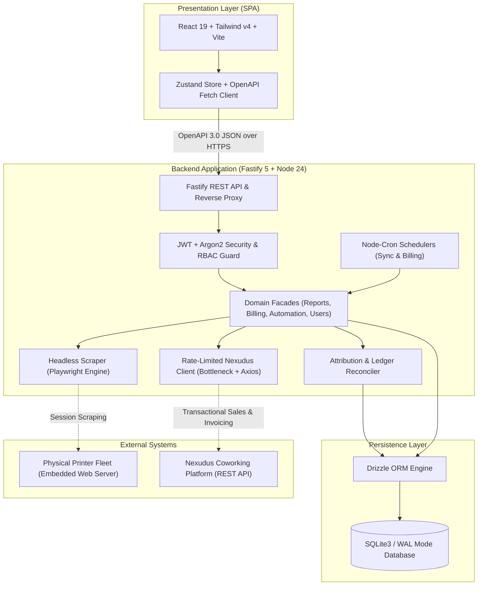

# 🌋 Magma Copy Manager

<p align="center">
  <strong>Enterprise Automated Hardware Metering & Multi-Account Billing Orchestrator</strong><br>
  <em>Bridging physical printer fleet telemetry with Nexudus Coworking ERP via an automated, auditable, and contract-first architecture.</em>
</p>

<p align="center">
  
  
  
  
  
  
  
  
  
  
</p>

---

## 📌 Executive Summary

Coworking spaces, creative studios, and shared office environments face significant revenue leakage and administrative overhead when reconciling paper copy consumption:
- Embedded printer hardware interfaces are legacy, isolated, and lack modern native webhooks.
- Coworking members frequently belong to multiple companies, subsidizing printing across separate corporate accounts.
- Invoicing cycles are prone to discrepancies if counters are read out-of-schedule.

**Magma Copy Manager** provides a resilient, autonomous pipeline connecting physical multi-function printer (MFP) hardware directly to **Nexudus Coworking ERP**. It scrapes hardware counters headlessly, maintains an immutable consumption ledger per paper format (`A4_BW`, `A4_COLOR`, `A3_BW`, `A3_COLOR`, `SRA3`), enables mathematical multi-account quota allocation, and executes transactional billing syncs with full auditability and rollback safety.

---

## 🏗️ System Architecture

Magma is designed as a modular monorepo (`core` backend engine + `app` SPA frontend) packaged for deployment as a single hardened Docker container.



---

## ⚡ Engineering Highlights & Technical Challenges Solved

### 1. Contract-First API & End-to-End Type Safety
- **Zero-drift OpenAPI Contract**: The root `openapi.yaml` acts as the single source of truth.
- Both backend request/response validation (`@fastify/swagger`) and frontend API clients (`openapi-fetch` + `openapi-typescript`) compile strictly against this schema.
- API changes trigger compile-time errors in the React UI if field contracts diverge.

### 2. Autonomous Headless Hardware Scraper (Playwright)
- Legacy printer firmware interfaces lack programmatic REST APIs and protect counters behind session-based HTML forms.
- Magma features an isolated Playwright worker that logs into the printer web server, extracts counter deltas per user across multiple paper categories, handles transient hardware timeouts, and records structured execution diagnostics.

### 3. Multi-Account Consumption Distribution (N-to-N Ledger)
- In coworking environments, members often work across multiple ventures or departments.
- Magma implements a dynamic quota distribution engine: users and admins can split a month's copies across multiple linked Nexudus billing accounts.
- **Mathematical Balance Invariant**: Enforces a strict 100% balance check prior to sync. Any remaining volume can be assigned with one click to the primary account.

### 4. Billing Cycle Attribution & Historical Reconciliation
- Solves the complex problem of manual mid-month synchronizations:
  - If counters are scraped or billed out-of-cycle, Magma tracks sales precedence by querying historical Nexudus product IDs and transaction timestamps.
  - Prevents duplicate invoicing while guaranteeing that billed copies remain locked to their corresponding billing cycle invoice view.
  - Includes automated database self-healing for legacy unassigned sales records upon application boot.

### 5. Resilient Automation & Observability Center
- Automated cron runners execute daily counter polling and end-of-period billing sweeps.
- **Observability Hub**: Real-time audit logs track execution runtimes, changed user counts, raw diagnostics, and individual user-level error traces.
- **Operator Overrides**: Immediate manual execution triggers with React portal-based modal overlays and optimistic button locking to prevent concurrent job races.

### 6. Production-Grade Single Container Packaging
- A multi-stage `Dockerfile` compiles the TypeScript backend and React SPA, pulls native Playwright dependencies and `better-sqlite3` bindings, and packages everything into a lean Node.js production image.
- Fastify statically serves the production frontend build alongside the API, simplifying hosting to a single container running behind Traefik or Nginx.

---

## 🛠️ Technology Stack

| Layer | Technology | Version | Purpose |
| :--- | :--- | :--- | :--- |
| **Backend Framework** | [Fastify](https://fastify.dev/) | `^5.8.4` | High-throughput, low-overhead HTTP API server |
| **Language** | [TypeScript](https://www.typescriptlang.org/) | `~5.9.3` | Type safety and domain contracts |
| **Database & ORM** | [SQLite3](https://github.com/WiseLibs/better-sqlite3) + [Drizzle ORM](https://orm.drizzle.team/) | `^0.45.1` | Embedded transactional storage, WAL mode, schema migrations |
| **Browser Automation** | [Playwright](https://playwright.dev/) | `^1.58.2` | Headless scraping of printer web management interface |
| **External Integration**| [Bottleneck](https://github.com/SGrondin/bottleneck) + [Axios](https://axios-http.com/) | `^2.19.5` | Resilient, rate-limited communication with Nexudus API |
| **Frontend Core** | [React](https://react.dev/) | `^19.2.4` | Component architecture with React 19 Concurrent features |
| **Styling & Design** | [Tailwind CSS](https://tailwindcss.com/) | `^4.2.2` | Glassmorphism UI, dark-mode first, responsive layouts |
| **State Management** | [Zustand](https://zustand.docs.pmnd.rs/) | `^5.0.12` | Lightweight, decoupled global client state |
| **Data Visualization**| [Recharts](https://recharts.org/) | `^3.8.1` | Monthly volume trends and analytics dashboards |
| **Testing** | [Vitest](https://vitest.dev/) + [Supertest](https://github.com/ladjs/supertest) | `^4.1.x` | Unit, integration, and API endpoint test suites |
| **Containerization** | [Docker](https://www.docker.com/) | Alpine / Slim | Multi-stage production container build |

---

## 📂 Repository Structure

```text
magma-copy-manager/
├── app/                        # Frontend Single Page Application (React 19 + Vite)
│   ├── src/
│   │   ├── components/         # Reusable design system (Portaled Modals, Badges, Tables)
│   │   ├── features/
│   │   │   ├── auth/           # Authentication context & login views
│   │   │   ├── automation/     # Diagnostics center, execution logs & manual triggers
│   │   │   ├── reports/        # Monthly consumption summaries & distribution editor
│   │   │   └── users/          # Member mapping (Printer User <-> Nexudus Account)
│   │   ├── store/              # Zustand application stores
│   │   └── services/api/       # Type-safe API client generated from OpenAPI
│   └── vite.config.ts          # Vite bundler configuration
│
├── core/                       # Backend Microservice Engine (Fastify + Drizzle)
│   ├── db/                     # Drizzle schema definitions & SQLite migrations
│   ├── facades/                # Domain Facade layer (Orchestration & Business Rules)
│   ├── services/
│   │   ├── automation/         # Cron jobs & auto-billing lifecycle services
│   │   ├── billing/            # Nexudus invoice creation & transaction manager
│   │   ├── report/             # Playwright web scraper service for printer hardware
│   │   └── reports/            # Monthly aggregation & period attribution logic
│   ├── routes/                 # Fastify REST endpoints organized by version (/api/v1)
│   └── server.ts               # Server bootstrap, security plugins & lifecycle hooks
│
├── docs/                       # Architecture diagrams, product specifications & decisions
├── infra/                      # CI/CD scripts & release automation assets
├── docker-compose.yml          # Container composition definition
├── Dockerfile                  # Multi-stage production container build
├── openapi.yaml                # Canonical OpenAPI 3.0 API Specification
└── package.json                # Monorepo task orchestration scripts
```

---

## 🚀 Getting Started

### Prerequisites
- **Node.js**: `24.x` or later
- **NPM**: `10.x` or later
- **Docker & Docker Compose** (for containerized execution)

### 1. Installation
Clone the repository and install root and package dependencies:
```bash
git clone https://github.com/OOTTEE/magma-copy-manager.git
cd magma-copy-manager

npm install
cd core && npm install
cd ../app && npm install
cd ..
```

### 2. Environment Configuration
Create an environment file in `core/.env`:
```env
PORT=3000
NODE_ENV=development
JWT_SECRET=your-secure-jwt-secret-key-at-least-32-chars
ENCRYPTION_KEY=your-aes-encryption-key-32-bytes-long

# Admin Initializer
INITIAL_ADMIN_EMAIL=admin@example.com
INITIAL_ADMIN_PASSWORD=changeMeImmediately

# Printer Hardware Fleet Credentials
PRINTER_HOST=http://192.168.1.50
PRINTER_USER=admin
PRINTER_PASSWORD=printerPassword

# Nexudus API Integration
NEXUDUS_API_URL=https://spaces.nexudus.com/api
NEXUDUS_USERNAME=apiUser@domain.com
NEXUDUS_PASSWORD=nexudusApiPassword
```

### 3. Database Migration
Initialize SQLite database and run Drizzle migrations:
```bash
npm run db:push --prefix core
```

### 4. Running the Development Environment
Run both backend and frontend concurrently:
```bash
# Terminal 1: Backend with hot reload
npm run dev --prefix core

# Terminal 2: Frontend with Vite HMR
npm run dev --prefix app
```
The application will be accessible at `http://localhost:5173`, proxying API calls to `http://localhost:3000`.

---

## 🧪 Testing & Quality Assurance

Unit and integration test suites cover critical business calculations, database migrations, authentication guards, and billing attribution invariants:

```bash
# Run backend test suite via Vitest
npm test --prefix core

# Build frontend to verify TypeScript strict type-checking
npm run build --prefix app
```

---

## 🐳 Docker Deployment

To build and run the production image locally using Docker Compose:

```bash
docker compose up -d --build
```

The container packages:
1. Compiled Fastify backend server listening on internal port `80`.
2. Optimized production bundle of the React 19 application.
3. Persistent SQLite database mounted at `./data`.

---

## 🔒 Security & Data Integrity

- **Cryptographic Hashing**: User credentials hashed using `argon2id`.
- **Encryption at Rest**: Sensitive third-party API keys and hardware credentials encrypted using AES-256-GCM.
- **Role-Based Access Control (RBAC)**: Strict separation between `admin` operators and `customer` self-service views.
- **Rate-Limiting & Backpressure**: External Nexudus API calls regulated via `bottleneck` leaky-bucket queues to respect provider rate limits.
- **Rollback Safety**: Every Nexudus invoice dispatch links generated transaction IDs to internal copy records, allowing deterministic rollbacks of entire billing batches if needed.

---

## 📄 License
This project is licensed under the [MIT License](LICENSE).
